# AI Pipeline Architecture

Resume-to-Analysis processing pipeline for matching candidates against job descriptions.

---

## Overview

Two parallel pipelines converge at an evaluation stage:

- **Pipeline A (Resume Processing)**: Converts uploaded PDF/image into structured JSON
- **Pipeline B (Job Calibration)**: Converts job description into evaluation framework
- **Convergence (Evaluation)**: Matches resume JSON against framework, produces scores and analysis

All LLM calls use BAML for structured output handling.

---

## Pipeline Diagram

```mermaid
flowchart TB
    subgraph Input["User Inputs"]
        PDF["PDF/Image Upload"]
        Form["Candidate Form Data<br/>(email, phone, etc.)"]
        JD["Job Description"]
        JobMeta["Job Metadata<br/>(title, pay, remote, dept)"]
    end

    subgraph PipelineA["Pipeline A: Resume Processing"]
        subgraph A1["A1: Application Creation"]
            A1_convert["Image to PDF<br/>(if needed)"]
            A1_meta["Generate Metadata<br/>(file_id, app_id, timestamp, hash)"]
            A1_gcs["Store PDF in GCS"]
            A1_db["Store Application Record in DB<br/>(before processing, for recovery)"]
            A1_convert --> A1_meta --> A1_gcs --> A1_db
        end

        subgraph A2["A2: PDF to Markdown (resume-parser repo)"]
            A2_links["Pre: Link Extraction<br/>(PyMuPDF)"]
            A2_github["Pre: GitHub URL Derivation<br/>(profile from repo URLs)"]
            A2_llm["LLM: Gemini 2.5 Flash Lite<br/>Verbatim extraction + smart formatting"]
            A2_clean["Post: Non-ASCII Removal"]
            A2_links --> A2_github --> A2_llm --> A2_clean
        end

        subgraph A3["A3: Markdown to JSON"]
            A3_llm["LLM: Gemini 2.5 Flash Lite<br/>BAML: resume_parser.baml"]
            A3_calc["Post: Duration Calculations<br/>(gaps, overlaps, totals)"]
            A3_warn["Post: Date Warnings<br/>(vague, missing, inverted)"]
            A3_anomaly["Post: Anomaly Detection<br/>(scam, prompt injection)"]
            A3_llm --> A3_calc --> A3_warn --> A3_anomaly
        end

        A1_db -->|"PDF file"| A2_links
        A2_clean -->|"Clean Markdown"| A3_llm
    end

    subgraph PipelineB["Pipeline B: Job Calibration"]
        subgraph B1["B1: JD to Calibration Questions"]
            B1_clean["Pre: Non-ASCII Removal"]
            B1_llm["LLM: Gemini 3 Flash Preview<br/>BAML: jd_parser.baml"]
            B1_out["Output: Skills, Complexity,<br/>Tradeoffs, Calibration Qs"]
            B1_clean --> B1_llm --> B1_out
        end

        subgraph B2["B2: Frontend Calibration"]
            B2_ui["UI: 3-page Form<br/>(selection-based)"]
            B2_select["Recruiter Selections:<br/>- Priority items<br/>- Expected outcomes<br/>- Required skills"]
            B2_response["Response: All options<br/>with selection flags"]
            B2_ui --> B2_select --> B2_response
        end

        subgraph B3["B3: Framework Generation"]
            B3_llm["LLM: Gemini 3 Flash Preview<br/>BAML: framework_creator.baml"]
            B3_enum["Post 0: Enum Normalization"]
            B3_validate["Post 1-2: Validation<br/>(completeness, ID fuzzy match)"]
            B3_weights["Post 3-4: Weight Normalization<br/>(selection multipliers)"]
            B3_derive["Post 5-7: Derive Dimensions<br/>(skill counts, weights)"]
            B3_review["Post 8: Suspicious Review<br/>(prompt injection check)"]
            B3_llm --> B3_enum --> B3_validate --> B3_weights --> B3_derive --> B3_review
        end

        B1_out -->|"Calibration Questions JSON"| B2_ui
        B2_response -->|"Selections + JD + Metadata"| B3_llm
    end

    subgraph Convergence["Convergence: Candidate Evaluation"]
        subgraph C1["C1: Evaluation"]
            C1_llm["LLM: Gemini 3 Flash Preview<br/>(CandidateEvals client, temp=0.7)<br/>BAML: candidate_evaluator.baml"]
            C1_enum["Post 1: Enum Normalization"]
            C1_reconcile["Post 2: Skill Reconciliation<br/>(catch LLM gaps)"]
            C1_manip["Post 3: Manipulation Check<br/>(30% penalty if detected)"]
            C1_flags["Post 4: Red Flag Summary<br/>(severity categorization)"]
            C1_exp["Post 5: Experience Summary"]
            C1_evidence["Post 6: Evidence Quality<br/>(keyword stuffing check)"]
            C1_score["Post 7: Final Scoring<br/>(technical fit, constraints, tradeoffs)"]
            C1_tier["Post 8: Tier Determination<br/>(strong/good/moderate/weak/mismatch)"]
            C1_llm --> C1_enum --> C1_reconcile --> C1_manip --> C1_flags --> C1_exp --> C1_evidence --> C1_score --> C1_tier
        end
    end

    subgraph Storage["Storage"]
        GCS["GCS: PDF Files"]
        JobsTable["Jobs Table:<br/>- Calibration Questions JSON<br/>- Framework JSON"]
        AppsTable["Applications Table:<br/>- Resume JSON<br/>- Evaluation Results<br/>- Scores, Tier"]
    end

    subgraph Output["Final Output"]
        Result["Evaluation Result:<br/>- Final Score & Tier<br/>- Skill Matches + Evidence<br/>- Red Flags & Blockers<br/>- Dimension Assessments<br/>- Interview Questions"]
    end

    %% Input connections
    PDF --> A1_convert
    Form --> A1_meta
    JD --> B1_clean
    JobMeta --> B1_llm

    %% Pipeline A to storage
    A1_gcs --> GCS
    A1_db -->|"Initial Record"| AppsTable
    A3_anomaly -->|"Resume JSON + Results"| AppsTable

    %% Pipeline B to storage
    B1_out --> JobsTable
    B3_review -->|"Framework JSON"| JobsTable

    %% Convergence inputs
    A3_anomaly -->|"Resume JSON"| C1_llm
    B3_review -->|"Evaluation Framework"| C1_llm

    %% Final output
    C1_tier -->|"Store Results"| AppsTable
    C1_tier --> Result
```



### Mermaid Link
```
https://newmo-oss.github.io/mermaid-viewer/?sequence-number=0#eJyNWFtv27gSfu+vGAjookXtpra3pwthzwK23OQkSLreuN19EA4EWhrL3PCiQ1J2UuTHH5AUJcVWNvWLeRnO9ZvhUFsmD/mOKANfF68AAHS9KRWpdnApqtqk0TeNyo919F9HYX+r5XkarZbnZ5eclAjfKiZJ0ds/l4qnUUJEQQti0M1hSQz5daPOfnuDnFA2gmonBY4ATf7+be/w1TKNruQGlqhzRStDpejvys0NGuJJ7Kho2RpqGI6gIg8jUMilwREUWJnAHEXx6qmRK1ohowLnaRSGMI/hFnXNEVZK5qg1FWVPfnt2Pkmj+SSGeVUxmhOrJiQKyZG+9jefZLkUe1QmjbzHjLQ+9GrTLQjEAou3p8e4M/UCBSrrx6f2binDjBYjIFXl/g3lqA3h1Qh2RO8G+JW5TqO1kQqtfKACLpL1KVmxCVR9624xl6qwh5YLr8EGt5aoah01gq1UoDCXe1QPAwo0foDx+LdgXxiXuQ7DYtOea4P21PnTNJpPY2eEkXBD1F0hDwLeKBe6cUWUBa7CSp4oMc0YFXc6jVYKY7im4g4+3xtFcmukt2v1cFOvlucDR0tqdvWmOXtBzX/qDXy7vYYlKronHYdKSRse2CrJnRqWSg/pwngaXV/fxHCBnAoK0/cf4ZwRvYNratBx+xPVhhjKAVs94R1obvN2KxUnxjwFacM7Z0hEGq2kNjF8kWI8XyeXl3CLXO4Je8YvPgbB0jBjjIeh4/pSfGZpNJ/FXWCMhKv171+OZc5+yP7F/OY6Bh/azIf2/YbwEwtmWU5YHgxe1qrJSsLymrmx9tEpSaVHYDHK3MhIQ9hpdGbZgajWgUubgX8RJagoGz57UtY4Ak4b8FMH7oFMnmVESE7YQ2A291NYosEe8HRO+MjmE68MUPG33xtg18bD2xzGVt8wbiQOR8olmaV8tHUcLFajxxYDHVkTbk+ZuGGIqaV3irxQXBe94rqIbQG3EaEbdVwq25OLSRotJjFcLS1uesTwR43axfHII4tJC3abmC9hfTE5xd2sQd1K4Z7ioQe8v4t/AN1ikkl7Uf5em6o2MazvKGN6BInkFcN7ah5GjtVXRQqU263d6hv0nCUuil7PMJS1eSHtFtM0WkxjOFdSGBTFM452cqZZTdPo22UMs3Fl7yR7STcoROaBN94QfYrmxTTzFGl0i7mqqUEF63BGx47JGFaKSkXNA1CDXDeLn+8rzA0WIGuTS45h/Rb/V1OFBWjnv1OJCnUlhUYr049imDMGsury+kDNDlrlYctIOcCppt6hwYowCxJe8vEsjRYz62PC8SDVHTTX84CPB8rb8zDbBoZZbtsIOQy3WYai5r6MwIcYPouawxd7CTD6/Rkl9oS5Pqw5NRlPY/jTr7WVJ3d4NShQ6xFcLmFbf//+AJyY/KSRWMyyA9JyZ3TDcTb+OYa/3NJTXY7wBLxmhlaMojqptotZVthLNGj5cfwp9tcqwpJyFLqr3w4kkMtaGD2CRpcBht7HDcNfYljXuqI5lbWG2879b47rLeQ7zO8G+LXJ6KMQxsG/Yd4oFKberDDzOg2DzCd5U2yHyp6/RB89jLtjHXj92S4Z4Z2tou/aztGe/aeinbj+rESRYxr1JjF03fznPWH1s8U7maRRMomHqewv+cHi+6aVaFlpyBlFYUZgkFf//vD+09te7uSBNEMvdjh7kkk/eyY/kD3JJLPdrMgpC8CcNkXe9cN2g/bTyOYLXF/fgO0xjiGUTDJOBK1C2tgGSdCqaU4gsbDzfGYfXkOFgjBbP7dQuDbhtBQnk8xVuYbhz/btUlhflrCuOSfqIWTgHl0tzonBUqrG2AF2eB+0+xi7aq2ojX9gN3BgTwsPF3fqXzbyfgX+qAmjplHhDh8O9vmgTb3dUlEOJ1kyyXQuVeD2KYZzKgiDdS4VFWXz0MN8J2hOGGypGUEuhTaKUFcMTLhnBzgbiqorBl8pKtd/KU5Fv1oZJUV5VkpZnHFZuJfX2QHJ3RmnerAeJt013SAsjFvshAUX/jBxoWuP3bfrwaVh7jwSJtaIJ9VjOJHt842U6N9xpMSeyhfJOo0ukrV/Pp1Thv1b8kpu9FeysXC3Q3DjcKc/X5Qagu5WPGr351UV2PbelEfsm4d3j19XRdwmM6FhsIBAPXJRfPZ975uyNPIY8rOeTp5jGp0ICfp02EP4yYkK0l0BuLFgQFtjA+RbO3wSavgJFkzmd6iC3u1VBnOtUWuOorXpUhhUtv6d9Lmtaa9f+68xFvSiqfFuw4ayeT03b2y37L689B7bbvFqGVrK7i3XfFfptZ2twO7TiG3HtceT2+y92i+SdVgKD4tLQQ0lrPluYJ8LAQOesn2iePJe8OFdiPaTUycKLY4V6i7QDsd+I1y8XtYRTB971EFI7/ID6j6AvaR19NhUgiGJPYy1wrsDQagHnHRAfdWrWs217j7JDHnmiLSh+T9Bh/MC
```

### Diagram Legend

| Symbol | Meaning |
|--------|---------|
| Solid arrows | Data flow |
| Subgraphs | Processing stages |
| Pre/Post labels | Pre-processing and post-processing steps |
| LLM blocks | AI model calls via BAML |

---

## Pipeline A: Resume Processing

### A1: Application Creation and Storage

**Trigger**: Candidate uploads PDF or image file with form data

**Process**:
1. Receive file upload (PDF or image)
2. Convert image to PDF if needed
3. Collect form data (email, phone, etc.)
4. Generate metadata:
   - File ID
   - Application ID
   - Timestamp
   - File hash (for duplicate detection; duplicates allowed for multi-job applications)
5. Store PDF file in GCS (path derived from metadata)
6. Store application record in database (before processing starts)

**Important**: Application record is stored in the database before pipeline processing begins. This ensures that if processing fails at any stage, the application record exists for retry/recovery.

**Output**: Application record in DB + PDF file in GCS

---

### A2: PDF to Markdown

**Model**: Gemini 2.5 Flash Lite (via `Gemini2_5FlashLite` client)

**Repository**: `resume-parser` (separate repository)

**Note**: This entire stage (link extraction, PDF to Markdown conversion, non-ASCII removal) is implemented in the `resume-parser` repository.

#### Pre-processing: Link Extraction

**Tool**: PyMuPDF

**Process**:
1. Extract hyperlinks from PDF (display text + actual URL)
2. Derive GitHub profile URLs from repository URLs if profile missing
3. Group links by type (github_profile, github_repo, linkedin, demo, email)
4. Format links for LLM context

**Note**: Image-converted PDFs have no extractable links; empty object passed to LLM.

#### Main Processing

**Inputs**:
- PDF file
- Extracted links
- Formatting prompt

**Process**:
- LLM processes PDF visually
- Extracts content **verbatim** (exact text preservation)
- Smart formatting via prompt:
  - Education section as tables
  - Bullet points use dashes/asterisks only
  - Avoids invalid characters
- Matches extracted links to visual indicators (blue text, underlines)
- Outputs markdown link format where matches found

**Output**: Markdown representation of resume

#### Post-processing: Non-ASCII Removal

- Remove non-ASCII characters (curly quotes, special dashes, etc.)
- Keep only standard keyboard characters
- Simplifies downstream processing

---

### A3: Markdown to JSON

**Model**: Gemini 2.5 Flash Lite (via `Gemini2_5FlashLite` client)

**BAML File**: `resume_parser.baml`

#### Main Processing

**Input**: Cleaned markdown from A2

**Output Schema** (defined in BAML):
- PersonalInfo (name, email, phone, location, links)
- Experience entries (company, title, dates, responsibilities)
- Education (institution, degree, field, dates)
- Projects (name, description, technologies)
- Skills (categorized)
- Certifications

**Date Format**: YYYY-MM strings, year-only as YYYY

#### Post-processing: Computed Fields

**File**: `resume_parser/post_processing.py`

Calculations (deterministic, no LLM):
- Duration calculations from date strings
- Total experience aggregation
- Employment gap detection (>6 months flagged)
- Overlap detection (concurrent roles)
- Years since graduation
- Date warnings (vague, missing, inverted, future dates)

**Anomaly Detection**:
- Scam detection flags
- Prompt injection detection

---

## Pipeline B: Job Calibration and Framework

### B1: JD to Calibration Questions

**Trigger**: Recruiter clicks "Create Job", fills form (title, pay, remote, department, ~7-10 fields), enters job description, clicks "Next"

**Model**: Gemini 3 Flash Preview (via `Gemini3FlashPreview` client)

**BAML File**: `jd_parser.baml`

#### Pre-processing: Non-ASCII Removal

- Remove non-ASCII characters from job description (curly quotes, special dashes, etc.)
- Keep only standard keyboard characters
- Ensures clean input for LLM processing

#### Main Processing

**Inputs**:
- Cleaned job description text
- Job metadata (title, compensation, department, etc.)

**Output**:
- Extracted skills with IDs and categories
- Role complexity assessment
- Tradeoff options with descriptions
- Calibration questions JSON:
  - Skills to verify
  - 60-day expectations (pick 2-3 from ~7 options)
  - Psychological scenarios
  - Priority selections

**Storage**: Calibration questions stored in jobs table

---

### B2: Frontend Calibration

**UI**: 3-page form (selection-based, minimal text input)

**Process**:
1. Frontend displays calibration questions from B1
2. Recruiter makes selections:
   - Priority vs non-priority items
   - Expected vs not expected outcomes
   - Required skill sets
3. All answers collected before submission

**Response Format**: All options sent with selection flags (not just selected items)

Example: 7 "60-day expectation" options shown, 3 selected -> all 7 sent with selection flags

---

### B3: Framework Generation

**Model**: Gemini 3 Flash Preview (via `Gemini3FlashPreview` client - same model, same client as B1)

**BAML File**: `framework_creator.baml`

**Inputs**:
- Recruiter selections (full JSON with selection flags)
- Original job description
- Job metadata

**Output**: Evaluation framework containing:
- Skill criteria with weights
- Hard constraints (dealbreakers)
- Tradeoff preferences
- Dimension weights

#### Post-processing: Framework Validation

**File**: `framework_post_processing.py`

8-stage pipeline (all role-agnostic):

| Stage | Name | Description |
|-------|------|-------------|
| 0 | Enum Normalization | PascalCase to snake_case conversion |
| 1 | Completeness Validation | Check >30% selected items present; add defaults if minor gaps |
| 2 | ID Validation | Fuzzy matching (Levenshtein) to fix LLM ID mismatches |
| 3 | Weight Normalization | Normalize all weights to sum to 1.0 |
| 4 | Selection Multipliers | Selected: 1.0x, Unselected: 0.3x weighting |
| 5 | Custom Item Boost | Validate user-added items have appropriate weights |
| 6 | Skill Count Validation | Verify skills per category |
| 7 | Dimension Weight Derivation | Derive weights from selection patterns; warn if >20% divergence |
| 8 | Suspicious Review | Flag items for human review; set requires_human_review flag |

**Security**: Prompt injection flagged in suspicious items

**Storage**: Framework stored as JSONB in jobs table (attached to job ID)

**Note**: Calibration is once per job (MVP). Recalibration requires creating new job.

---

## Convergence: Candidate Evaluation

### C1: Candidate Evaluation

**Model**: Gemini 3 Flash Preview (via `Gemini3FlashPreview_CandidateEvals` client)

**Note**: This client uses higher temperature (0.7) for nuanced assessment.

**BAML File**: `candidate_evaluator.baml`

**Inputs**:
- Resume JSON (from Pipeline A)
- Evaluation Framework (from Pipeline B)

**Output**:
- Skill matches with evidence (WHERE/WHAT/SCALE)
- Constraint results
- Tradeoff signals
- Dimension assessments (5 dimensions)
- Red flags with severity
- Manipulation detection results
- Interview questions

#### Post-processing: Scoring and Analysis

**File**: `evaluation_post_processing.py`

8-step pipeline:

| Step | Name | Description |
|------|------|-------------|
| 1 | Enum Normalization | Normalize output enums |
| 2 | Skill Reconciliation | Catch LLM gaps; create entries for skills demonstrated but not matched |
| 3 | Manipulation Check | Detect AI manipulation attempts; apply 30% penalty if found |
| 4 | Red Flag Summary | Categorize by severity (info/investigate/concern); calculate verification confidence |
| 5 | Experience Summary | Total months, group by type, current employment status |
| 6 | Evidence Quality | Detect keyword stuffing (>50% keyword_only); summarize evidence distribution |
| 7 | Final Scoring | Calculate technical fit, constraint penalties, tradeoff alignment, dimension blend |
| 8 | Tier Determination | Assign tier based on score thresholds |

**Scoring Details**:
- Per-skill depth: strong=1.0, moderate=0.7, basic=0.4, unclear=0.2
- Evidence modifiers: strong=1.0, weak=0.85, keyword_only=0.7
- Constraint penalties: dealbreaker=0.7, required_day1=0.85, acceptable_gap=0.95
- Manipulation penalty: 30% reduction if detected

**Tier Thresholds**:
| Tier | Score Range |
|------|-------------|
| strong_match | >= 8.5 |
| good_match | >= 7.0 |
| moderate_match | >= 5.5 |
| weak_match | >= 4.0 |
| mismatch | < 4.0 |

**Note**: Append "_flagged" suffix if manipulation detected.

**Storage**: Results stored in applications table (linked to application ID)

**Status**: Update application status to "done"; frontend displays analysis to recruiter.

---

## Client Configurations

All clients use Google AI provider with BAML.

| Client | Model | Temp | Top P | Top K | Thinking Budget | Usage |
|--------|-------|------|-------|-------|-----------------|-------|
| `Gemini2_5FlashLite` | gemini-2.5-flash-lite | 0 | 0.1 | 1 | 0 | Resume parsing (A2, A3) |
| `Gemini3FlashPreview` | gemini-3-flash-preview | 0 | 0.1 | 1 | 2000 | JD parsing (B1), Framework (B3) |
| `Gemini3FlashPreview_CandidateEvals` | gemini-3-flash-preview | 0.7 | 1 | 10 | 2000 | Candidate evaluation (C1) |
| `Gemini3Pro` | gemini-3-pro-preview | 0.2 | 0.5 | 5 | 1000 | (Reserved, not currently used) |

**Key Principle**: Each prompt uses its own client. Do not reuse clients across prompts unless parameters are identical.

---

## Security and Anomaly Detection

| Detection Type | Location | Action |
|----------------|----------|--------|
| Manipulation Detection | Evaluation post-processing | 30% score penalty, blocker flag, "_flagged" tier suffix |
| Prompt Injection | Framework post-processing | Flag for human review |
| Red Flags | Evaluation post-processing | Categorize by severity, affect verification confidence |
| Keyword Stuffing | Evaluation post-processing | Flag if >50% keyword_only with 3+ skills |
| Scam Detection | Resume post-processing | Flag suspicious patterns |

**Red Flag Types**:
- short_tenure
- employment_gap
- title_experience_mismatch
- vague_contributions
- unverifiable_claims

**Red Flag Severities**: info, investigate, concern

**Verification Confidence**:
- Low: any "concern" flag OR 3+ "investigate" flags
- Medium: 1-2 "investigate" flags
- High: only "info" flags

---

## File Reference

### External Repository

| Repository | Purpose |
|------------|---------|
| `resume-parser` | PDF to Markdown conversion, link extraction, non-ASCII removal (Stage A2) |

### Backend Files

| File | Purpose |
|------|---------|
| `baml_src/resume_parser.baml` | Resume markdown to JSON schema |
| `baml_src/jd_parser.baml` | Job description parsing schema |
| `baml_src/framework_creator.baml` | Evaluation framework generation |
| `baml_src/candidate_evaluator.baml` | Candidate evaluation schema |
| `baml_src/clients.baml` | LLM client configurations |
| `resume_parser/post_processing.py` | Duration, gaps, date warnings |
| `resume_parser/link_preprocessor.py` | Link extraction, GitHub URL derivation |
| `framework_post_processing.py` | Framework validation (8 stages) |
| `evaluation_post_processing.py` | Scoring and analysis (8 steps) |
| `main.py` | FastAPI endpoints |

---

## API Endpoints

| Endpoint | Purpose | BAML Function | Post-processing |
|----------|---------|---------------|-----------------|
| `POST /api/jobs/parse` | Parse job description | `ParseJobDescription()` | - |
| `POST /api/jobs/create-framework` | Create evaluation framework | `CreateEvaluationFramework()` | `framework_post_processing` |
| `POST /api/resume/parse` | Parse markdown resume | `ParseResume()` | `resume_parser.process_resume()` |
| `POST /api/candidates/evaluate` | Evaluate candidate | `EvaluateCandidate()` | `evaluation_post_processing` |
